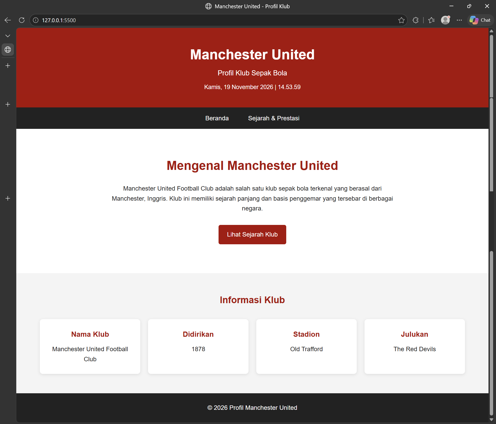
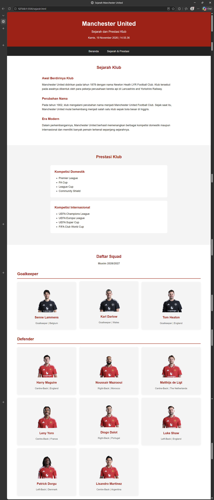

# Manchester United Website

Website profil Manchester United yang menampilkan informasi klub, sejarah berdirinya klub, prestasi, serta daftar squad pemain.

Project ini dibuat menggunakan HTML, CSS, dan JavaScript dengan memanfaatkan TheSportsDB API untuk mengambil informasi pemain.

## Preview Website

### Halaman Beranda



### Halaman Sejarah dan Squad



## Fitur Website

- Menampilkan profil dan informasi Manchester United.
- Menampilkan tanggal dan waktu secara real-time.
- Menampilkan sejarah berdirinya Manchester United.
- Menampilkan daftar prestasi klub.
- Menampilkan daftar squad Manchester United.
- Mengambil informasi pemain melalui TheSportsDB API.
- Mengelompokkan pemain berdasarkan posisi secara otomatis.
- Menampilkan foto, posisi, dan kewarganegaraan pemain apabila tersedia dari API.

## Teknologi yang Digunakan

- **HTML** – Membuat struktur dan konten halaman website.
- **CSS** – Mengatur tampilan, layout, dan responsivitas website.
- **JavaScript** – Mengatur interaksi, tanggal dan waktu, serta pengambilan data API.
- **TheSportsDB API** – Menyediakan data profil pemain.

## Struktur Project

```text
Project/
├── screenshots/
│   ├── beranda.png
│   └── sejarah-squad.png
├── index.html
├── sejarah.html
├── style.css
├── script.js
└── README.md
```

## API yang Digunakan

Project ini menggunakan TheSportsDB API untuk mencari informasi pemain berdasarkan nama.

Endpoint:

```text
https://www.thesportsdb.com/api/v1/json/123/searchplayers.php?p={nama_pemain}
```

Nama pemain ditentukan secara manual melalui array di dalam `script.js`. Informasi profil lainnya diambil dari API, termasuk foto, posisi, dan kewarganegaraan apabila tersedia.

## Cara Menjalankan Project

1. Download atau clone repository project.
2. Buka folder project.
3. Jalankan file `index.html` menggunakan browser.
4. Buka halaman Beranda atau Sejarah & Prestasi melalui navigasi website.
5. Pastikan koneksi internet tersedia agar data pemain dapat diambil dari TheSportsDB API.

## Pengembang

Project ini dibuat sebagai project pembelajaran pengembangan website menggunakan HTML, CSS, dan JavaScript serta penggunaan API.